# 🩺 Doctor Tracker — Frontend

A secure admin portal for managing doctors, their patients, and clinic analytics.

| | |
|---|---|
| **Frontend repo** | this repo (Next.js) |
| **Backend repo** | [doctor-tracker-backend](https://github.com/samircd4/doctor-tracker-backend) (Express + MongoDB) |
| **Live demo** | _add link after deployment_ |
| **Demo login** | `admin@test.com` / `Admin@123` |

---

## 1. Description

**Doctor Tracker** is an admin dashboard for clinics that need one clear place to manage their medical team and the patients in their care. After a secure login, an admin can:
- add doctors and open any doctor to see, add, edit or remove their patients;
- browse every patient with instant search, filters for condition, doctor, gender and admission date, and pagination;
- follow the clinic at a glance: totals, admissions over time, each doctor's caseload, and the mix of patient conditions.

It is built with **Next.js** on the frontend and a separate **Express + MongoDB** REST API. Every list is backed by indexed database queries, so it stays fast as the data grows.

### Features
- 🔐 **Secure login.** JWT in an httpOnly cookie, protected pages and API, and a session check on every request.
- 👩‍⚕️ **Doctors.** Create; search; filter by specialization, hospital and date added; paginate; open a doctor to manage their patients.
- 🧑‍🤝‍🧑 **Patients.** List all patients; search; filter by condition, doctor, gender and admitted date; add (with a doctor picker), edit (including moving to another doctor) and delete.
- 📊 **Dashboard.** 4 KPIs and 3 charts (admissions per month, top 10 doctors by patients, condition breakdown), all from one aggregated API call.
- 📱 **Responsive and accessible.** Tables become cards on phones. Loading, empty and error states. Keyboard friendly, with labels on every control.

### Tech stack
| Layer | Technology |
|---|---|
| Framework | Next.js 16 (App Router), React 19, JavaScript (JSX) |
| Styling / UI | Tailwind CSS 4, shadcn/ui (Base UI), lucide-react icons |
| Server state | TanStack Query 5 |
| Charts | Recharts 3 |
| Backend (separate repo) | Node.js, Express 5, MongoDB with Mongoose 9, Zod 4 |

---

## 2. Setup guide

### Prerequisites
- **Node.js 20.9+** and npm
- **MongoDB**, for example with Docker:
  ```bash
  docker run -d --name doctor-mongo -p 27017:27017 -v doctor-mongo-data:/data/db mongo:7
  ```
  (or a local MongoDB / a free MongoDB Atlas cluster)

### Step 1: Start the backend API
```bash
git clone https://github.com/samircd4/doctor-tracker-backend.git
cd doctor-tracker-backend
npm install
cp .env.example .env        # then set JWT_SECRET to a long random string
npm run seed                # creates the admin user + 30 doctors + 500 patients
npm run dev                 # API on http://localhost:5000
```
Check it: http://localhost:5000/api/health should return `{"status":"ok","db":"up"}`.

### Step 2: Start the frontend (this repo)
```bash
git clone https://github.com/samircd4/doctor-tracker-frontend.git
cd doctor-tracker-frontend
npm install
cp .env.example .env.local
npm run dev                 # app on http://localhost:3000
```
Open http://localhost:3000 and sign in with **`admin@test.com` / `Admin@123`** (or click **Use demo** on the login page).

### Environment variables (`.env.example`)
| Variable | Repo | Default | Purpose |
|---|---|---|---|
| `API_URL` | frontend | `http://localhost:5000` | Where the `/api` proxy forwards requests |
| `PORT` | backend | `5000` | API port |
| `MONGODB_URI` | backend | `mongodb://127.0.0.1:27017/doctor_tracker` | MongoDB connection string |
| `JWT_SECRET` | backend | _(change it)_ | Secret used to sign login tokens |
| `CLIENT_URL` | backend | `http://localhost:3000` | Frontend origin allowed by CORS |

### Scripts
| Command | What it does |
|---|---|
| `npm run dev` | Development server |
| `npm run build` / `npm start` | Production build / serve it |
| `npm run lint` | ESLint |

---

## 3. System architecture

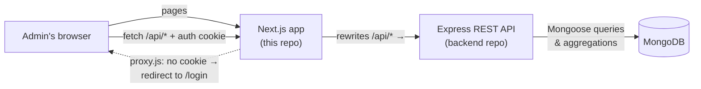

- **One origin for the browser.** The browser only talks to the Next.js app. `next.config.mjs` rewrites every `/api/*` call to the Express server, so the login cookie works without any CORS or cross-site setup.
- **Authentication.** `POST /api/auth/login` checks the password (bcrypt) and sets a signed JWT in an **httpOnly, SameSite=Lax** cookie, which JavaScript can't read. `src/proxy.js` (Next 16's middleware) redirects visitors without the cookie to `/login`. The API's `requireAuth` middleware verifies the token on every request, so it is the real security check.
- **Data flow.** Pages fetch through one helper (`src/lib/api.js`) and **TanStack Query**, which caches each filter combination and refetches after changes. A 401 sends the user back to the login page.
- **Backend.** Routes → Zod validation → controllers → MongoDB. Lists use indexed `find` + `countDocuments`, and the dashboard uses aggregation pipelines (see the backend README).

### Project structure
```
src/
├── app/
│   ├── login/page.jsx          # sign-in page
│   ├── (app)/layout.jsx        # sidebar + header shell for logged-in pages
│   ├── (app)/dashboard/        # KPIs + charts
│   ├── (app)/doctors/          # list + [id] detail page
│   └── (app)/patients/         # list with add / edit / delete
├── components/                 # reusable UI (tables, filters, forms, dialogs, charts)
│   └── ui/                     # shadcn/ui primitives
├── hooks/useDebounce.js
├── lib/                        # api client, constants, formatting
└── proxy.js                    # route guard
```

---

## 4. Technical decisions

### Decision 1: TanStack Query for server state, instead of Redux or Context
**Problem.** Almost all state in this app is *server data*: doctor and patient lists for many search/filter/page combinations, plus dashboard stats. It must stay in sync after every add, edit or delete.

**Options considered.**
- **Redux Toolkit:** needs slices, actions and hand-written loading/error/caching logic for every list.
- **Context + `useEffect`:** simple, but no caching or deduplication. Every page change shows a spinner, and data easily goes stale.
- **TanStack Query** *(chosen)*.

**Why.**
- Each query is cached by its key, e.g. `["patients", { q, condition, page }]`, so going back to a filter or page you've seen is instant.
- `placeholderData: keepPreviousData` keeps the current rows visible while the next page loads, so the table doesn't flicker.
- After a mutation, one line (`invalidateQueries(["patients"])`) refreshes the lists, the doctor's patient count, and the dashboard.
- Loading and error states come for free, and the pages stay small and readable.

**Trade-off.** Purely UI state (dialog open, current filters) still lives in plain `useState`. That's fine at this size. A larger app with shared UI state might add a small store, or keep filters in the URL so links can be shared.

### Decision 2: Indexed MongoDB queries for search, filters and pagination
**Problem.** The doctor and patient lists combine search, several filters, date ranges, sorting and pagination. The doctor list also needs each doctor's patient count. Done naively, that means full collection scans plus one extra query per doctor (N+1).

**What we did** (backend repo):
- **One compound index per filter path**, with the equality field first and the sort/date field second, e.g. `{ condition: 1, admittedAt: -1 }`, `{ doctor: 1, admittedAt: -1 }`, `{ specialization: 1, createdAt: -1 }`.
- **`find().lean()` and `countDocuments()` run in parallel** (`Promise.all`) with the same filter, so both use the same index.
- **Patient counts for a page of doctors come from one aggregation** (`$match: { doctor: { $in: ids } }` → `$group`), not 10 separate queries.
- **The dashboard is one request.** Counts, top-10 doctors, monthly admissions and the condition breakdown are aggregation pipelines run in parallel.
- **Search uses an escaped, case-insensitive regex instead of a text index.** Text indexes only match whole words, so typing "card" would not find "Cardiology". The regex runs on top of the indexed filters, and user input is escaped so it can't break the query.

**Measured with `explain("executionStats")`** on 500 seeded patients:

| Query | Index used | Docs examined → returned |
|---|---|---|
| Doctors list (newest first) | `createdAt_-1` | 10 → 10 |
| Doctors by specialization | `specialization_1_createdAt_-1` | 1 → 1 |
| Patients list | `admittedAt_-1` | 10 → 10 |
| Patients by condition + date | `condition_1_admittedAt_-1` | 10 → 10 |
| One doctor's patients | `doctor_1_admittedAt_-1` | 10 → 10 |

Each query reads only the documents it returns. There are no collection scans.

**Trade-off.** Skip/limit pagination is simple and fine for thousands of rows. For millions, we'd switch to cursor (keyset) pagination, and to MongoDB Atlas Search for fuzzy, typo-tolerant search.

---

## 5. Visual evidence

| Page | Desktop (1440 × 900) | Mobile (390 × 844) |
|---|---|---|
| Login | 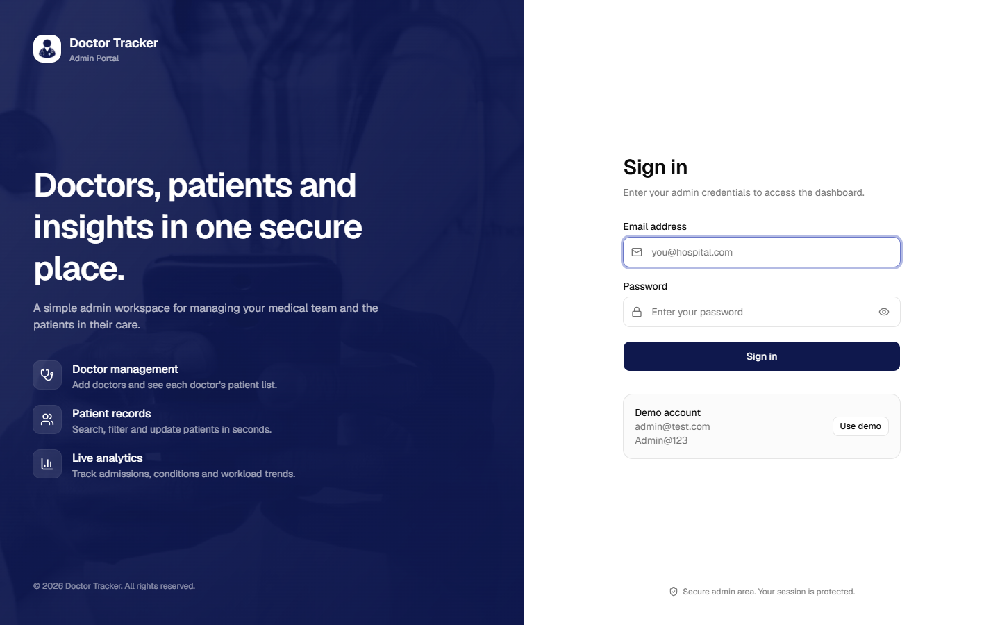 | 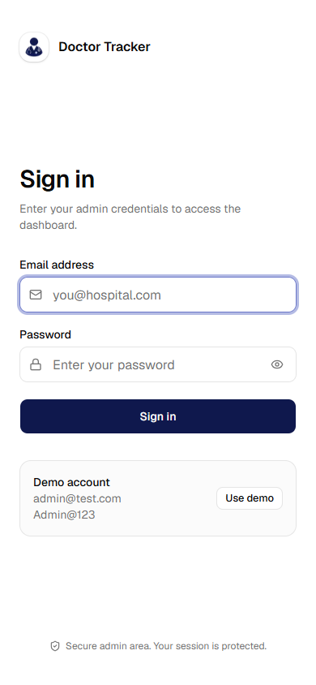 |
| Dashboard | 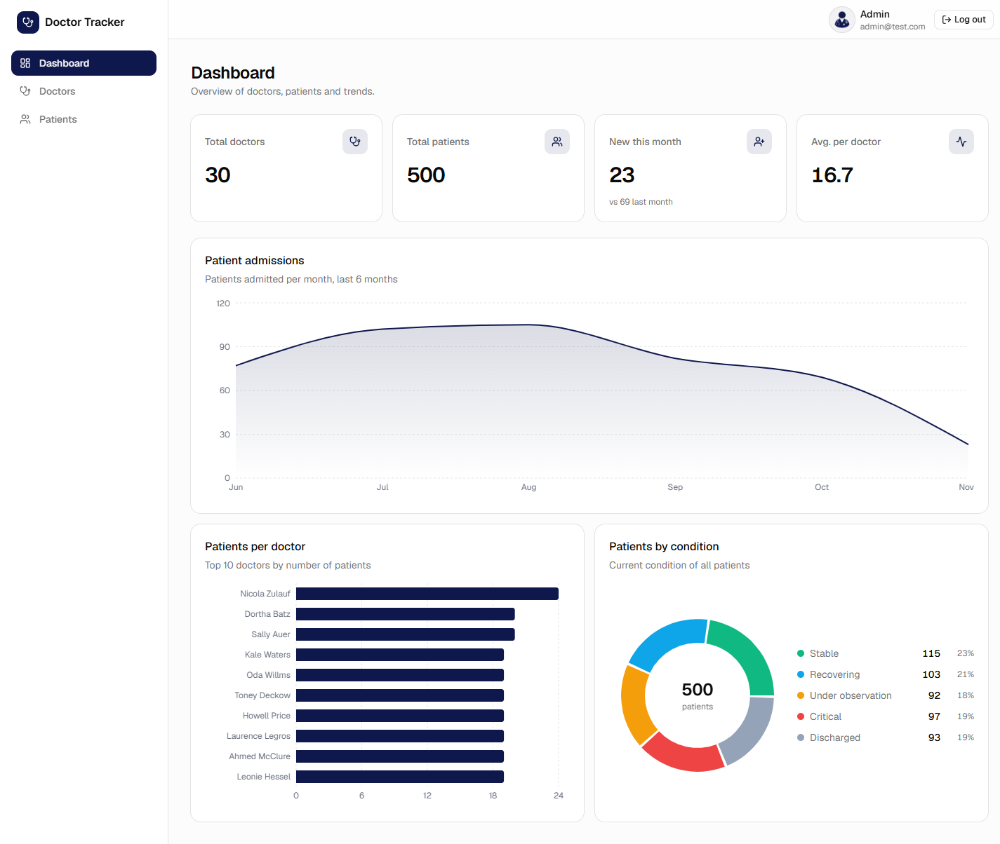 | 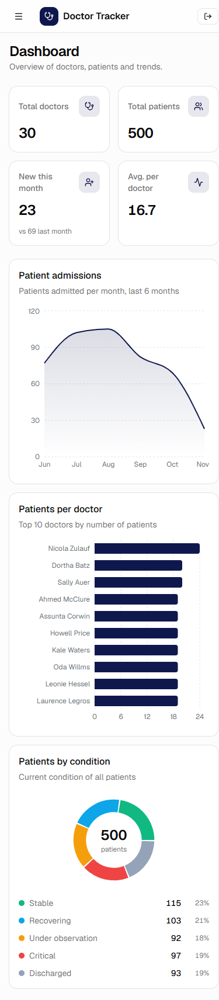 |
| Doctors | 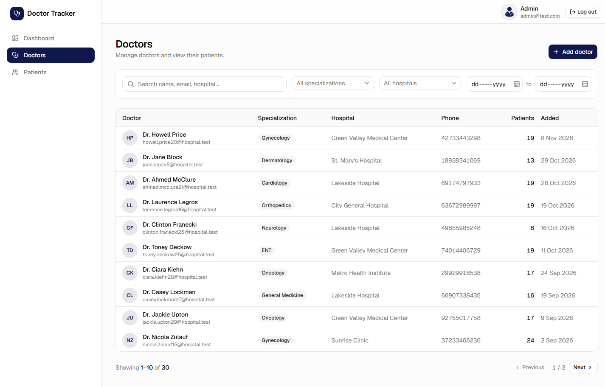 | 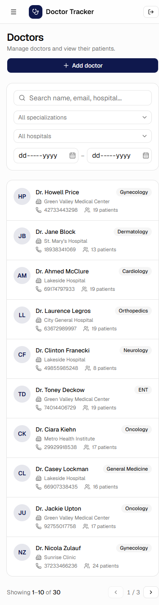 |
| Doctor detail | 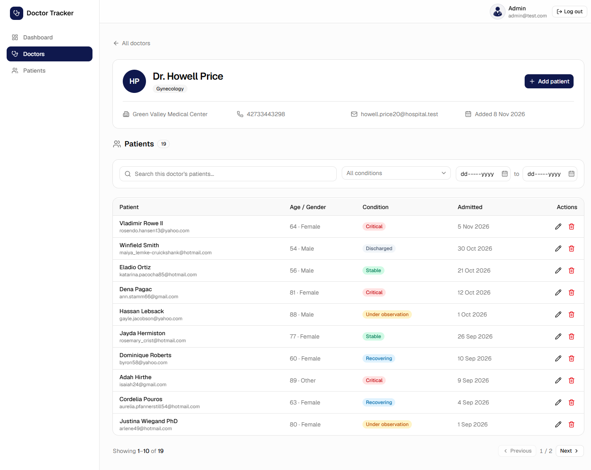 | 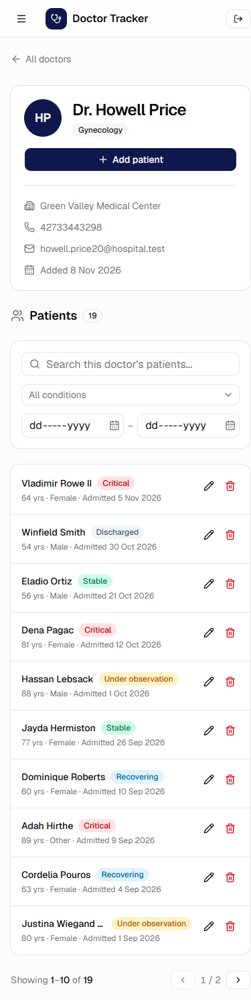 |
| Patients (filtered: Critical) | 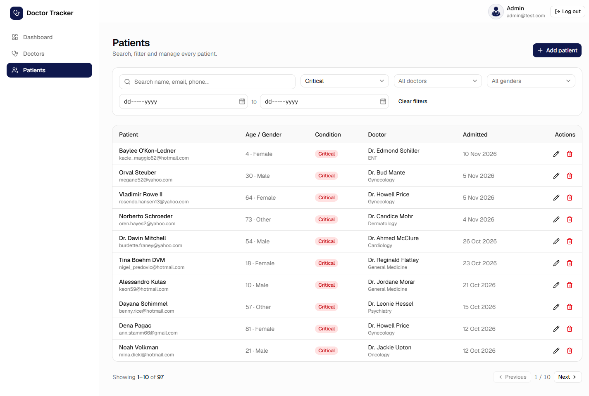 | 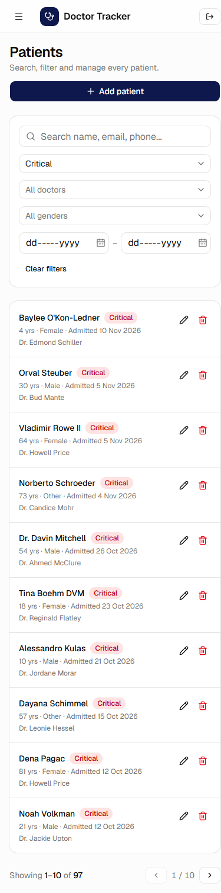 |
